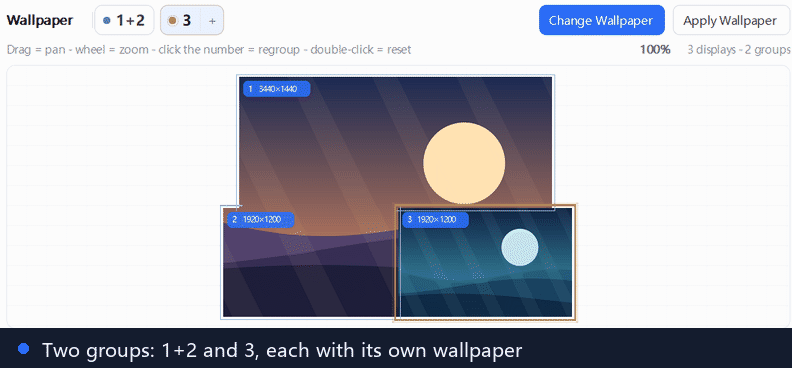
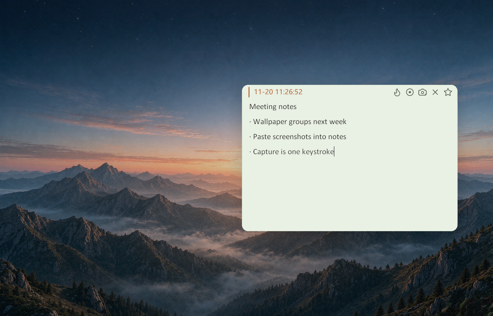
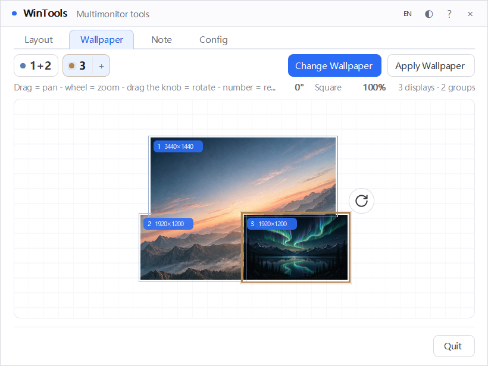
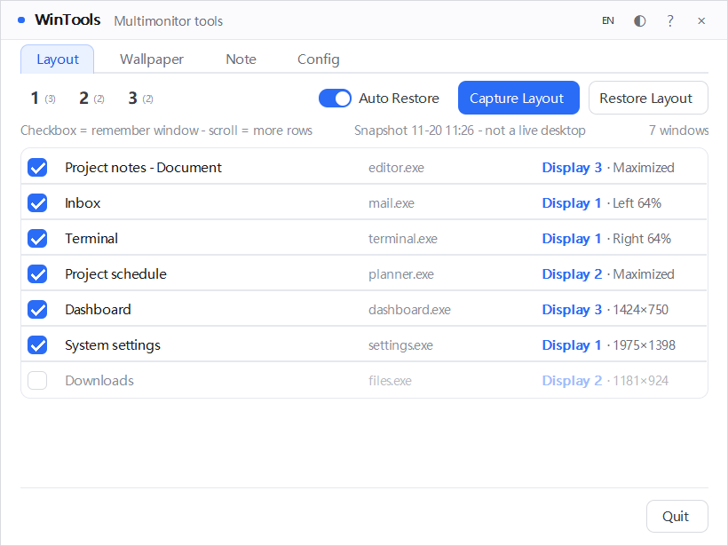

# WinTools

**A multi-monitor toolbox for Windows** — one executable for wallpapers, windows and notes.
No installer; no network access unless you opt in to update checks.

## What it does

- **One wallpaper across displays**: pan, zoom and rotate one picture to frame every screen.
- **Window layout memory**: after a display sleeps or reconnects, windows return where they were.
- **Sticky notes on top**: five paper colours, stars, pasted screenshots, restored on restart.
- **Area screenshot**: one shortcut, drag a box; paste it anywhere, or straight into a note.
- **Optional updates**: off by default; read the release notes first, then install in one click.
- **Desktop widgets**: the calendar and friends are being polished; more to come.

| Wallpaper | Layout |
|---|---|
|  |  |

Bilingual UI · light and dark themes · editable shortcuts · MIT licensed

[Download](https://github.com/duochunyu/WinTools/releases/latest) · Windows 10/11 x64 · about 1.2 MB

Free code signing provided by [SignPath.io](https://signpath.io/), certificate by
[SignPath Foundation](https://signpath.org/). What that means for the download you have, and
whether this release carries a signature yet, is in
[CODE_SIGNING_POLICY.md](CODE_SIGNING_POLICY.md).
