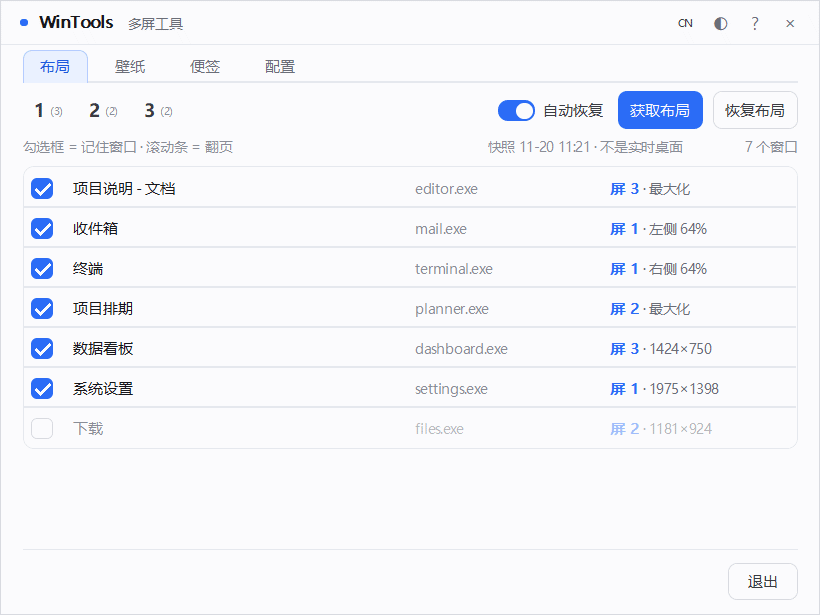
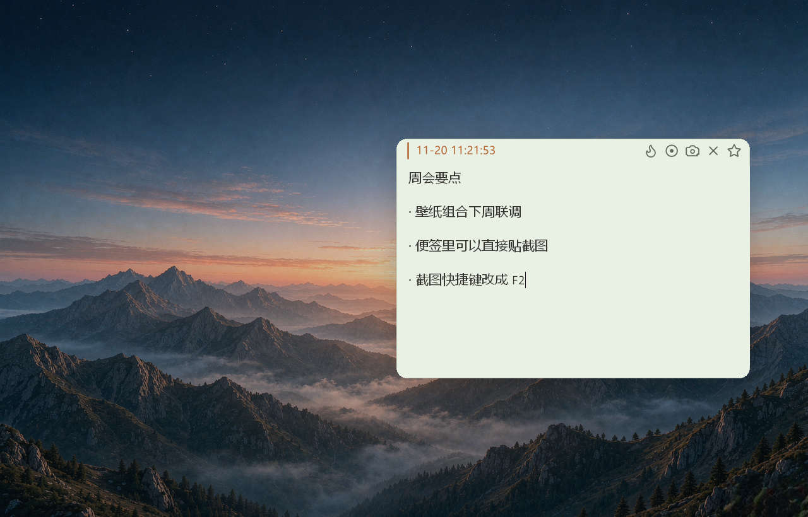
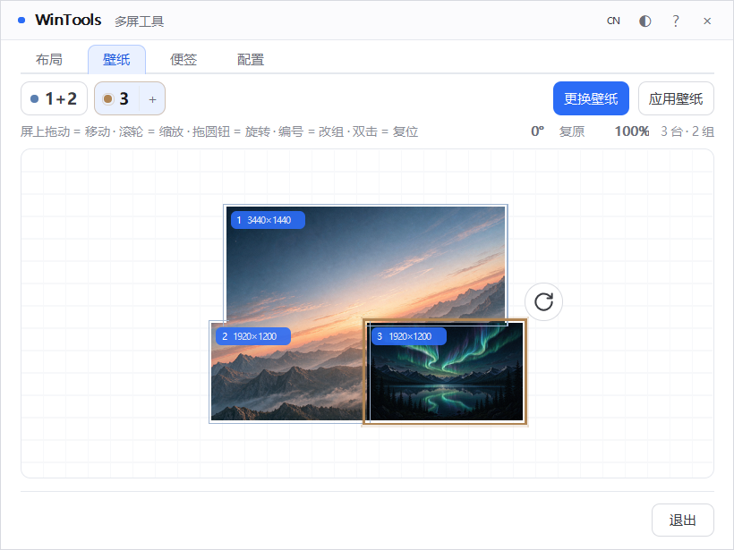
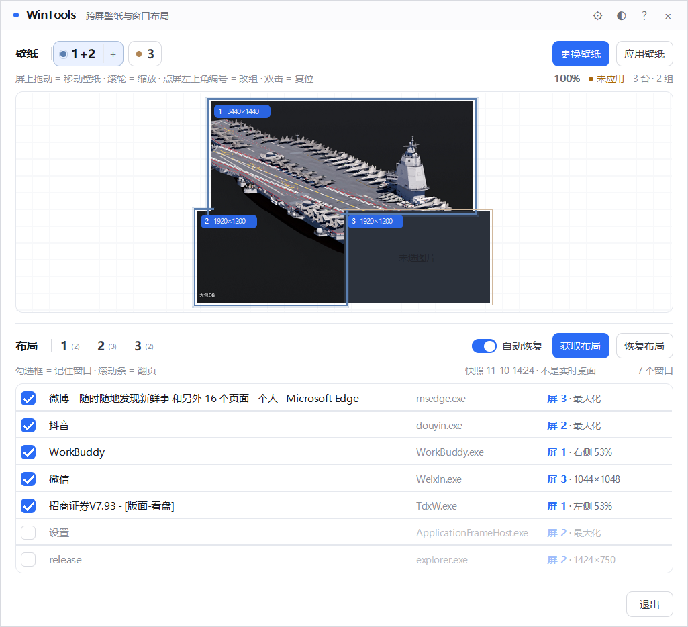

# WinTools

**Windows 多屏桌面工具箱** —— 一个 exe，管好壁纸、窗口和便签。免安装，默认不联网，可选自动更新。

## 核心功能

- **跨屏壁纸**：一张图铺满所有屏幕，拖动、缩放、旋转取景。
- **窗口位置记忆**：显示器断电、重连后，窗口自动回到原来的屏幕和位置。
- **屏幕便签**：置顶记事，五色纸、星标、截图直接贴，重启可恢复。
- **框选截图**：一个快捷键框选，截图可粘贴，也可直接贴进便签。
- **可选自动更新**：默认关闭；检查后先看更新说明，再一键下载安装。
- **桌面小工具**：日历等插件正在打磨，后续持续更新。

| 跨屏壁纸 | 窗口布局 |
|---|---|
|  |  |

中英双语 · 深浅主题 · 快捷键可改 · MIT 开源

[下载最新版](https://github.com/duochunyu/WinTools/releases/latest) · Windows 10/11 x64 · 约 1.2 MB
